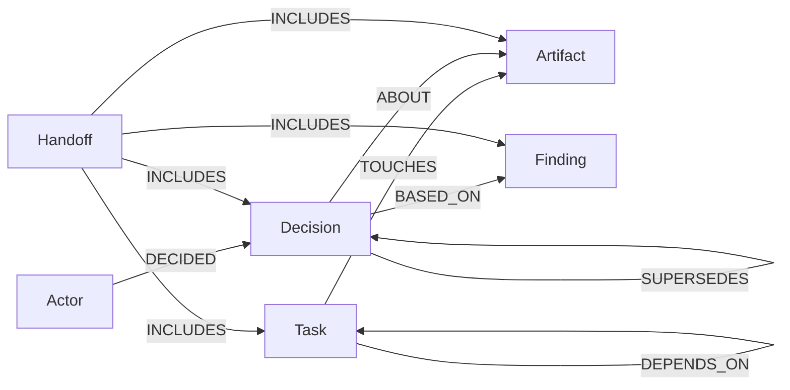
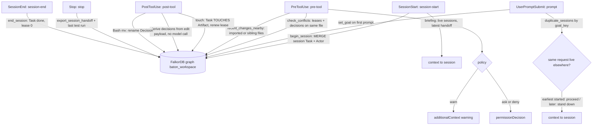

# Diagrams

Verified against `src/baton/graph/schema.py` (labels, relationship types) and
`src/baton/hooks/events.py` (handlers, `HANDLERS` map), plus the Cypher in
`src/baton/core/sessions.py` for what each hook writes.

## Data model

Each session is represented by a `Task` with `session = true` (created at session start, id
`sess_<hash>`); the `Actor` node is created alongside it. `Decision.kind` is one of
note/rename/interface/config/storage/other. Task status: open/claimed/done/released. Decision status:
open/superseded/retracted/tainted.

## Hook flow

Six handlers in `HANDLERS`, wired in `plugin/hooks/hooks.json` to SessionStart, UserPromptSubmit,
PreToolUse and PostToolUse (matcher Write|Edit|MultiEdit|NotebookEdit|Bash), Stop and SessionEnd.
If the store is unreachable the hooks print nothing (fail open).

